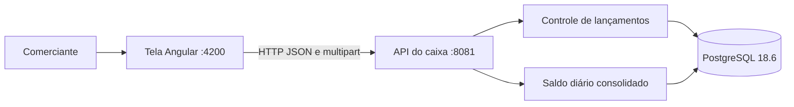
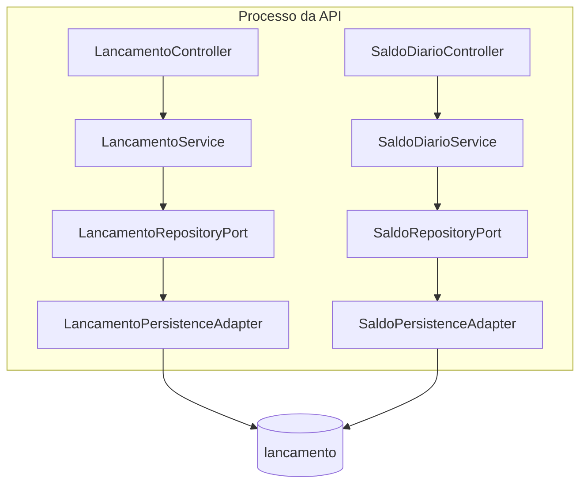
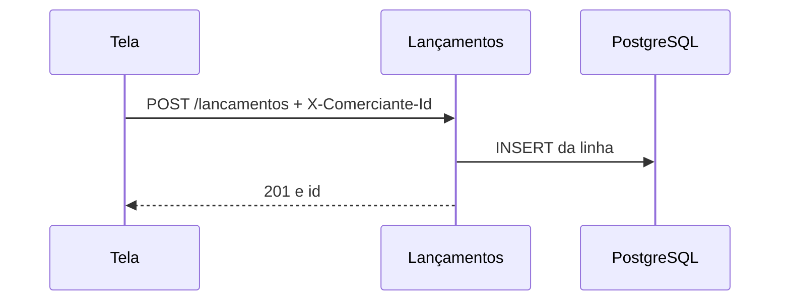
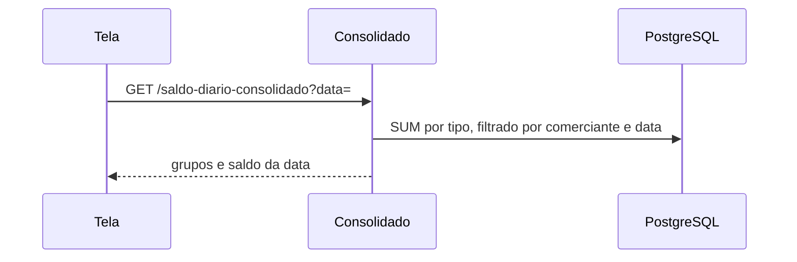
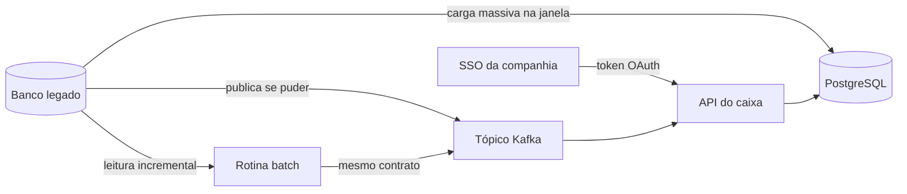

# Arquitetura — caixa do comerciante

Documento para a banca do desafio de Arquiteto de Soluções. Descreve o que está no repositório, a decisão que a prova sustenta e o que o tempo deixou como evolução. Diagrama e fluxo estão aqui. Código que não muda a decisão não está repetido.

## Visão

O valor para a organização é o caixa do dia bater com os lançamentos daquele dia, do mesmo comerciante, sem outro sistema no meio. Duas capacidades fazem isso: controle de lançamentos e saldo diário consolidado. Elas se integram pela mesma base de lançamentos e se separam no caminho de falha que a prova consegue mostrar: gravar e consultar não chamam o saldo; a tela mantém a lista se o pedido de saldo falha; no pico, registro e consulta concluem enquanto o saldo recebe a carga.

A escolha de tipo é monólito modular na API, com a tela num segundo processo. Cinquenta requisições por segundo, por dez segundos, cabem num processo. Separar o consolidado em outro serviço agora criaria uma segunda cópia do saldo e uma janela em que o relatório mente. A fronteira de processo fica desenhada como evolução, com gatilho explícito.

O repositório desta prova sobe sozinho. A transição, para quando a companhia já tem caixa legado e diretório de usuários no SSO, está na seção Migração.

## O que o desafio pede

| Pedido | Onde esta entrega responde |
| --- | --- |
| Domínio funcional e capacidade de negócio | Seção Domínio |
| Requisitos funcionais e não funcionais refinados | Seções seguintes |
| Arquitetura alvo, com decisão e fluxo | Seções Tipo, Alvo e Fluxo |
| Justificativa de ferramenta e de tipo | Seção Tipo |
| Linguagem à escolha | Java 17 e Angular 22 |
| Testes | `PicoDoConsolidadoTest` e a suíte da tela. Execução no `README.md` |
| README de funcionamento e execução local | `README.md` |
| Repositório público com a documentação | Este arquivo e o README na raiz. A pasta local ainda não tem remoto |
| Consolidado pode cair sem levar o lançamento | Seção Isolamento de falha |
| Pico: 50 por segundo, perda máxima de 5% | Seção Pico |
| Evolução, custo, observabilidade, critério para consumir serviço | Seções finais |
| Segurança com autenticação ainda aberta no código | Seção Segurança. Alvo: OAuth no SSO da companhia |
| Arquitetura de transição | Seção Migração. Carga entre bancos e convivência por Kafka |

## Domínio

Um comerciante opera o próprio caixa. Vários comerciantes podem existir. Cada um lê e grava só as próprias linhas. No código desta prova o operador é um só, identificado pelo cabeçalho. No alvo OAuth o token separa duas coisas: o perfil de quem opera e o cliente cujo caixa entra na consulta e na inclusão.

Lançamento é o fato: data, valor, direção, tipo de pagamento, descrição e comprovante opcional. Direção é `debito` ou `credito`. Esses nomes não designam bandeira de cartão. O tipo de pagamento é conjunto fechado, o mesmo da tabela e da API.

Valor é positivo, com duas casas, até `NUMERIC(19, 2)`. Zero e negativo são recusados. O saldo de um tipo na data é créditos menos débitos daquele tipo. O saldo da data é a soma desses tipos. A escala permanece em duas casas. Dia sem lançamento de um tipo não inventa grupo para esse tipo.

Cadeia de valor: o comerciante registra o fato, a API persiste, a consulta devolve a página, o consolidado agrega a data, o comerciante lê o saldo. Não há fechamento de dia, rede, ERP nem adquirente. O tipo de pagamento não dispara integração externa.

## Capacidades

**Controle de lançamentos.** Registrar, corrigir, listar e abrir comprovante. A lista aceita data, tipo e direção como filtro. Página padrão de 20, teto de 20.

**Saldo diário consolidado.** `GET /saldo-diario-consolidado?data=AAAA-MM-DD`. O corpo traz `grupos` e `saldo da data`. Cada grupo traz `tipo_pagamento`, `total de créditos`, `total de débitos` e `saldo do tipo`. A agregação é SQL no conjunto do comerciante e da data. O controlador só subtrai e soma o que o SQL devolveu.

A tela pede um dia por vez e, no período, soma os `saldo da data` já recebidos. Dia sem grupo fica de fora dessa soma. A tela não recalcula crédito menos débito.

## Requisitos funcionais

1. Registrar lançamento em `multipart/form-data` devolve `201` e o `id`.
2. Corrigir o lançamento do próprio comerciante em `PUT /lancamentos/{id}`. Comprovante novo substitui o anterior quando os bytes vêm no pedido. Não há exclusão.
3. Listar só as linhas daquele `comerciante_id`. Id de outro caixa não acha a linha.
4. Abrir o comprovante da própria linha em `application/octet-stream`.
5. Devolver o saldo da data pedida, com um grupo por tipo que teve lançamento naquela data.
6. Recusar cabeçalho ausente ou que não é UUID, valor fora do formato, direção fora do par, tipo fora do conjunto e descrição vazia. A recusa sai como problema HTTP.

## Requisitos não funcionais

**Isolamento de falha.** O serviço de lançamento permanece utilizável se o consolidado falha. No código, `gravar` e `listar` não chamam o saldo. Na tela, falha do saldo limpa o bloco do consolidado e conserva a lista. A prova de carga registra e consulta no meio do pico, na mesma API.

Limite honesto: as duas capacidades dividem o processo, o pool e o Postgres. Queda da JVM ou do banco leva as duas. A separação entregue é de caminho e de interface, suficiente para o número do desafio e insuficiente para uma falha de nó. O gatilho para separar processo está na evolução.

**Pico.** 50 requisições de saldo por segundo, 10 segundos, 500 pedidos. Perda máxima de 5%. Perda é resposta que não traz o saldo da data com os totais de cada tipo presente, inclusive timeout e exceção. Resposta `200` sem `saldo da data`, sem um total ou sem os grupos não conta como sucesso. Durante a janela, um `POST /lancamentos` e um `GET /lancamentos` concluem. A prova é `core/src/test/java/com/caixa/consolidado/PicoDoConsolidadoTest.java`. Ela sobe PostgreSQL 18.6 à parte e usa porta aleatória. Não depende do compose da 8081.

**Dinheiro.** Duas casas decimais na entrada, na coluna e na agregação. Sem ponto flutuante.

**Isolamento de dados.** Toda leitura e escrita de caixa filtra `comerciante_id`. Índice em `(comerciante_id, data)`.

**Contrato estável.** Nomes JSON do saldo usam os textos já publicados, com espaço e acento. Cliente que renomeia o campo quebra a prova de perda.

## Tipo de arquitetura

Monólito modular. Dois módulos de negócio dentro de um deploy, mais um processo de tela.

| Peça | Escolha | Por quê |
| --- | --- | --- |
| Tipo | Monólito modular | Uma base, um saldo, uma equipe. O saldo é a soma das linhas. Duas escritas do mesmo fato criam caixa divergente |
| Microsserviço | Evolução, não o alvo desta prova | Passa a valer quando o consolidado precisar cair sozinho, com projeção própria alimentada pelo lançamento já aceito |
| SOA | Fora | Não há barramento nem vários sistemas de retaguarda para orquestrar |
| Serverless | Fora | O pico é rajada curta sobre dado relacional com comprovante binário. Função por pedido soma frio de start e fragmenta a transação |
| API | Java 17, Spring Boot 4.1.2, `spring-boot-starter-webmvc` | Um processo, HTTP, teste de carga no mesmo runtime da entrega |
| Tela | Angular 22 | Processo estático, sem regra de saldo do dia |
| Dados | PostgreSQL 18.6 | `NUMERIC`, restrição de direção e de tipo, índice do caixa |
| Esquema | Liquibase, `ddl-auto: none` | A tabela nasce do changelog. O runtime não altera coluna |
| Entrega | Docker Compose | Três processos: Postgres, API, tela. A API espera `pg_isready` |
| Licença | Temurin, Spring Boot, Angular, PostgreSQL, nginx, Node | Uso livre. Estimativa de licença da stack: zero |

O pedido do desafio deixa a linguagem em aberto. Java e Spring foram escolhidos porque o teste de 500 pedidos concorrentes, o binário do comprovante e a transação relacional ficam num runtime só, com Testcontainers na mesma versão do banco de produção.

## Arquitetura alvo

Dentro da API a dependência segue um sentido: controlador, serviço, porta, adaptador de persistência. O saldo lê `lancamento`. O lançamento não chama o saldo.

## Fluxo de dados

Registro:

Saldo do dia:

Integração entre tela e API nesta prova: HTTP/1.1, JSON na consulta e no saldo, `multipart/form-data` no registro e na correção, cabeçalho `X-Comerciante-Id`. CORS libera `http://127.0.0.1:4200` e `http://localhost:4200`, métodos `GET`, `POST`, `PUT` e `OPTIONS`. A tela usa a URL absoluta `http://127.0.0.1:8081`. O nginx da imagem só entrega o estático na 4200. No alvo, o mesmo contrato HTTP leva `Authorization: Bearer` no lugar desse cabeçalho.

Nesta prova não há fila, cache nem segundo banco. O lançamento aceito entra no saldo na próxima leitura, porque os dois leem a mesma tabela. O Kafka da convivência está na seção Migração.

## Isolamento de falha

O requisito pede que o controle de lançamentos não fique indisponível se o consolidado cair.

Entregue:

- o registro não depende do cálculo do saldo
- a consulta da lista não depende do cálculo do saldo
- a tela trata falha do saldo sem apagar a lista
- o pico exige registro `201` e consulta `200` enquanto 500 pedidos de saldo estão em voo

Ainda no mesmo processo. Reinício do container da API recupera as duas capacidades juntas. Redundância de nó e failover de banco não estão nesta prova. Cinquenta por segundo durante dez segundos não pedem cluster. O cluster entra na evolução, quando a rajada ou o isolamento de nó passarem deste número.

## Pico e escala

A meta refinada é a do teste, não uma frase solta:

- entrada só pela API, no `GET /saldo-diario-consolidado`
- janela de 10 segundos, 50 partidas por segundo, 500 pedidos
- cada partida bem-sucedida devolve o saldo da data pedida
- perda ≤ 5%, contando corpo incompleto, status inútil, timeout e erro
- no quinto segundo, registro e consulta do caixa completam até o fim da janela

Escala horizontal, balanceamento e cache ficam para quando uma instância deixar de cumprir essa meta ou quando o consolidado for extraído. A API não guarda sessão. Uma segunda instância, à frente do mesmo Postgres, é o primeiro passo de réplica. Cache do saldo, chave `(comerciante_id, data)`, só depois da extração, invalidado no registro aceito. Cache dentro do processo único antecipa leitura velha sem ganhar isolamento.

## Segurança

Autenticação e autorização ficam abertas no código desta prova. O alvo já está decidido: OAuth contra o SSO que a companhia já usa como base de usuários. O caixa não cria diretório próprio.

Implementado hoje:

- a chamada leva `X-Comerciante-Id`
- ausência ou formato inválido recebe recusa, nos lançamentos e no saldo
- a query restringe esse identificador
- comprovante e lançamento não seguem em query string
- CORS limita a origem da tela
- não há `DELETE`

Alvo, ainda sem código:

A tela autentica no SSO. O SSO emite o token OAuth. Todo request à API leva `Authorization: Bearer`. O token traz o perfil de quem opera e o cliente, que é o comerciante do caixa. Consulta, inclusão e correção leem essas duas claims. O identificador solto no cabeçalho deixa de mandar no filtro.

O perfil autoriza a ação: registrar, corrigir, consultar, abrir comprovante, pedir saldo. O cliente recorta a linha. Um perfil válido no cliente A não lê nem grava o caixa do cliente B. Claim ausente, token vencido ou assinatura inválida recusa a chamada antes do serviço.

TLS fica na borda entre tela e API. Em local o tráfego continua HTTP claro até essa entrega. Limite de taxa e teto do comprovante continuam no mesmo alvo, ao lado do token.

Critério para consumir este serviço:

- token OAuth do mesmo SSO, com perfil e cliente
- a API usa só as claims, inclusive numa integração servidor a servidor
- TLS
- timeout explícito no cliente chamador
- registro idempotente quando o chamador puder repetir o `POST` depois de perder a resposta. Hoje cada `POST` é um fato novo
- tipo de pagamento continua rótulo. Adquirente é outro contexto, com credencial própria

## Observabilidade

O diferencial fica aberto no painel e nas métricas. O alvo já está decidido em cima do que o processo já emite. A prova de 5% continua sendo o teste. Em produção, a mesma definição de perda vira número contínuo.

Implementado hoje:

- saúde do processo em `/actuator/health`, única exposição do actuator
- log de registro aceito, registro recusado, correção aceita, correção recusada, consulta vazia, consulta devolvida, saldo devolvido e saldo em perda
- perda no log é a mesma do pico: a chamada não devolveu o saldo da data

Alvo, ainda sem código:

Cada request ganha um identificador no log, o mesmo nos dois caminhos. Quatro números saem pelo actuator, no formato que o Prometheus já lê:

- pedidos de saldo e a parcela que foi perda, na janela de 10 segundos, para comparar com o teto de 5%
- latência só da parcela que devolveu o saldo
- registro e consulta aceitos, para ver o caixa vivo enquanto o saldo perde
- atraso do consumidor Kafka e falha do batch, quando a migração estiver no ar

O alerta dispara quando a perda passa de 5% na janela, ou quando o registro recusa enquanto o saldo ainda responde. O painel é o que a companhia já operar ao lado do SSO. O caixa exporta métrica. Não adota uma segunda ferramenta de APM.

## Custo

Ordem de grandeza para um caixa pequeno em produção, em novembro de 2026. Não é cotação.

| Item | Estimativa |
| --- | --- |
| Licenças da stack escolhida | 0 |
| Execução local com Docker | 0 além da máquina de quem roda |
| Uma instância pequena para API e tela, 2 vCPU e 4 GB | USD 15 a 40 por mês, conforme a região |
| PostgreSQL gerenciado pequeno, com backup | USD 15 a 50 por mês |
| Tráfego do pico de prova, 500 pedidos | desprezível |

A prova cabe nesse desenho. Cluster, réplica de leitura e cache aumentam a faixa e só se pagam no gatilho da seção de escala. SSO e Kafka entram na migração se a companhia já os tiver. O caixa não soma licença de diretório novo.

## Migração

Vale quando a companhia já opera um caixa legado e a base de usuários já está no SSO. O usuário entra pelo SSO. A carga e a convivência tratam só o fato de lançamento.

Dois tempos.

**Carga massiva.** Uma janela copia o histórico do banco legado para o PostgreSQL do caixa novo. O passo transforma a linha antiga no contrato atual: comerciante, data, valor com duas casas, direção, tipo de pagamento, descrição, comprovante quando existir, e o identificador de origem. A carga é idempotente por esse identificador. O ponto de corte fica gravado. O que nascer depois do corte não entra de novo por esta via.

**Convivência.** Enquanto as duas aplicações atendem, o caixa novo consome um tópico Kafka produzido pela aplicação que ainda registra no legado. O payload é o mesmo contrato da carga, um fato por mensagem, com o identificador de origem. O consumidor aplica inclusão ou correção. A mesma chave idempotente impede que a carga e o tópico gravem o fato duas vezes.

Se o legado não puder publicar no Kafka, uma rotina batch lê a base legada a partir do último ponto lido e publica nesse mesmo tópico. O caixa novo continua com um único consumidor. A compatibilidade do campo fica no produtor: ou o legado, ou o batch, com o mesmo formato.

O corte encerra a convivência quando o legado deixa de receber lançamento novo e o consumidor alcança o fim do tópico. A base de usuários permanece no SSO.

## Evolução

1. OAuth no SSO da companhia, token em todo request, perfil e cliente nas claims, no lugar de `X-Comerciante-Id`. TLS na borda.
2. Carga massiva e consumidor do tópico Kafka. Batch de compatibilidade se o legado não publicar.
3. Teto de tamanho do comprovante e limite de taxa no saldo.
4. Idempotência do registro feito na tela, para repetição não duplicar fato.
5. Extrair o consolidado para outro processo com projeção alimentada pelo lançamento já aceito, quando a queda do relatório precisar poupar o processo do caixa.
6. Segunda instância da API e, só então, cache do saldo por comerciante e data.
7. Métrica de perda, latência do saldo devolvido e atraso do consumidor Kafka, ao lado do log que já existe.

## Fora desta versão

Rede de lojas, ERP, adquirente e fechamento formal do dia. Exclusão de lançamento. Diretório de usuários dentro do caixa. O SSO da companhia permanece a base.
